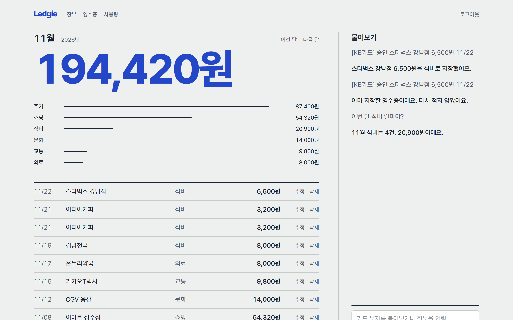
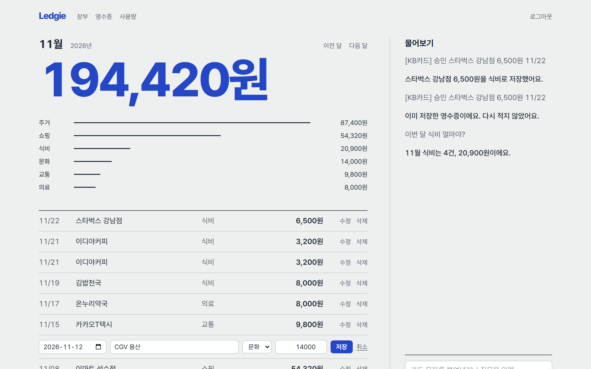
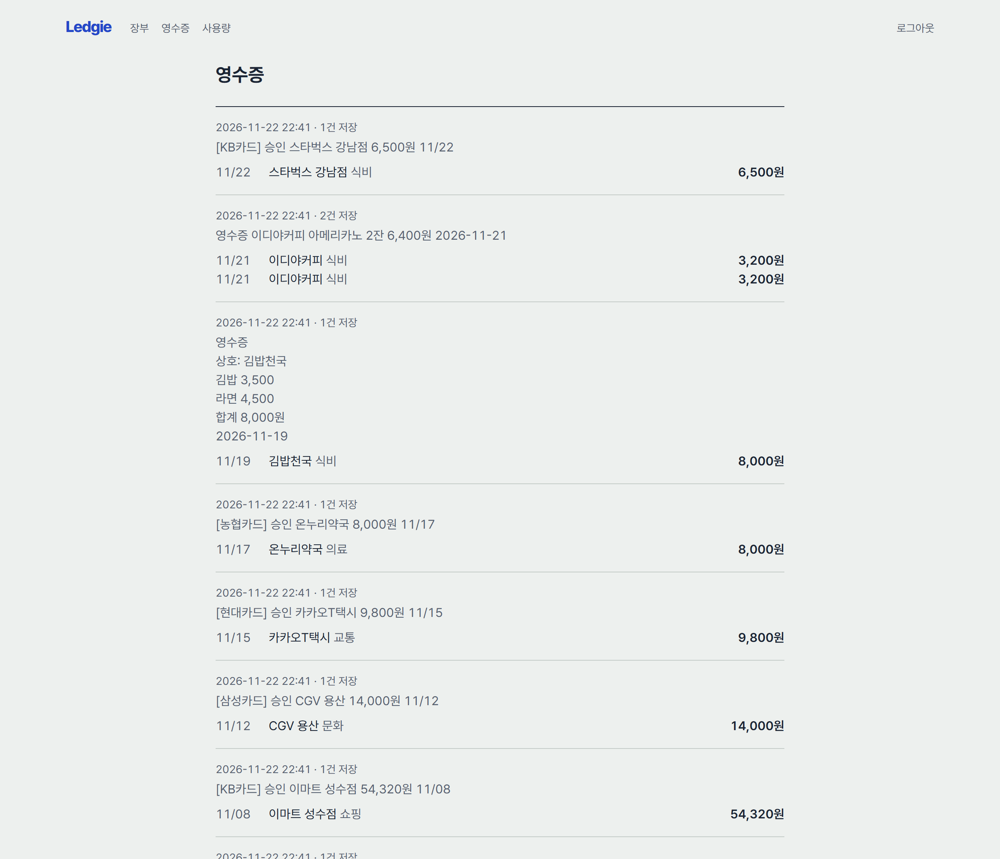
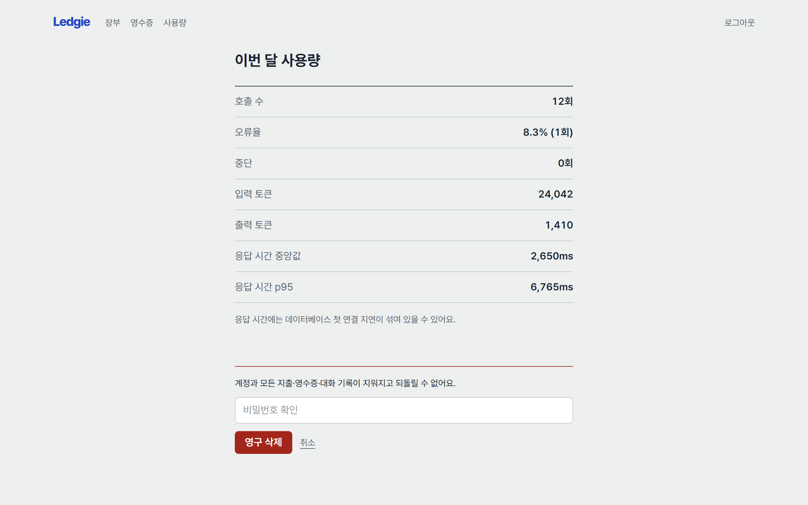
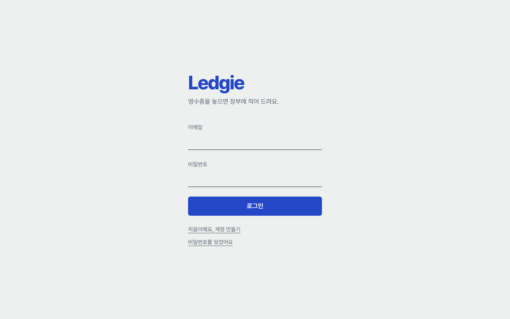

# Ledgie

영수증 사진이나 카드 문자를 올리면 에이전트가 가게·금액·분류를 뽑아 저장하고, 채팅으로 월별 지출을 물어볼 수 있는 가계부.
Next.js 16 · Neon(Postgres) · Better Auth · Vercel AI SDK.

## 화면

> 아래 화면의 지출·대화·사용량은 시연용 예시 데이터로 채웠다.

### 장부와 채팅
월 합계, 분류별 합계(괘선 길이), 지출 목록. 오른쪽 채팅에 카드 문자나 영수증 사진을 넣으면 에이전트가 항목을 읽어 저장하고, 같은 영수증을 다시 넣으면 중복으로 건너뛴다.



### 지출 수정·삭제
행마다 수정·삭제가 있다. 수정하면 날짜·가게·분류·금액을 그 자리에서 고친다.



### 영수증 기록
올린 원문과 거기서 읽어낸 항목, 저장 건수. 같은 영수증 안의 동일 항목(커피 2잔)도 각각 저장된다.



### 사용량과 계정 삭제
이번 달 호출 수·오류·중단·토큰·응답 시간. 비밀번호를 다시 확인하면 계정과 모든 데이터를 지운다.



### 로그인
이메일·비밀번호 로그인, 계정 만들기, 비밀번호 재설정 메일 요청.



## 실행

```powershell
npm install
copy .env.example .env.local   # 값을 채운다
npm run migrate                # 스키마와 RLS 적용
npm run dev
```

로컬에서 Neon 없이 확인하려면 Docker로 Postgres를 띄우고 `.env.local`의 두 연결 문자열을 그 DB로 맞추면 된다.

```powershell
docker run -d --name ledgie-pg -e POSTGRES_PASSWORD=dev -e POSTGRES_DB=ledgie -p 54329:5432 postgres:17
```

## 구조

- `db/migrations` — 인증 테이블, 앱 테이블, RLS. `npm run migrate`가 번호 순서대로 한 번씩 적용한다.
- `lib/db.ts` — `withUser(userId, fn)`: 트랜잭션 안에서 `app.user_id`를 심고 쿼리한다. 정책은 이 값으로 본인 행만 허용한다.
- `lib/expenses.ts` — 지출 저장(중복 판단 포함)·수정·삭제. 에이전트 도구와 장부 화면의 Server Action이 같이 쓴다.
- `lib/agent` — 이미지 판별(`classify`), 모델 선택(`model`), 도구(`tools`). 에이전트 루프와 SSE는 AI SDK가 처리한다.
- `proxy.ts` — 세션 쿠키가 없으면 로그인으로 보내는 1차 확인. 실제 확인은 각 페이지의 `requireUserId()`와 RLS가 한다.
- `app/api/chat/route.ts` — 로그인 확인, 새 메시지 검증, 일일 호출 상한, 스트리밍, 토큰·지연 기록. 클라이언트는 새 메시지 하나만 보내고 이전 대화는 서버가 DB에서 읽는다.
- `app/(app)` — 장부, 영수증 목록, 사용량.

## 데이터 보안 규칙

- 앱은 `app_user` 역할로, 인증 모듈은 `auth_user` 역할(인증 테이블 4개만)로 접속한다. 둘 다 RLS를 우회하지 못한다. `DATABASE_URL_OWNER`는 마이그레이션 전용이다.
- 앱 테이블의 `user_id`는 `user`를 참조하고 `on delete cascade`다. 계정을 삭제하면(사용량 화면) 지출·영수증·대화 기록이 함께 지워진다.
- 모든 앱 테이블은 `force row level security`이고 정책은 `user_id = current_setting('app.user_id')`이다.
- 카드·계좌번호를 저장하는 컬럼은 없다.
- API 키는 서버 환경변수에만 둔다.

## 모델 전환

`LLM_PROVIDER=ollama`(개발) 또는 `anthropic`(운영). 이미지 입력은 비전 모델이 있을 때만 받는다.
(`OLLAMA_VISION_MODEL` 또는 `ANTHROPIC_VISION_MODEL`)

## 중복 저장

- 같은 원문(공백 차이 무시)은 사용자당 한 번만 저장된다.
- 원문이 달라도 같은 가게·금액·날짜의 지출이 있으면 저장하지 않고 사용자에게 확인한 뒤 저장한다.
- 한 영수증 안의 동일 항목(같은 커피 2잔)은 모두 저장된다.

## 메일

비밀번호 재설정과 이메일 확인 메일은 `RESEND_API_KEY`, `MAIL_FROM`이 있으면 Resend로 보낸다. 없으면 개발 환경에서 링크를 콘솔에 출력한다. 발송을 설정한 뒤 `REQUIRE_EMAIL_VERIFICATION=true`로 이메일 확인을 강제할 수 있다.

## 테스트

```powershell
npm test                              # RLS 교차 접근(4개 테이블), 중복·수정·삭제, 합계, 채팅 API 검증·상한
npx tsx scripts/eval-extract.mts      # 서버를 띄운 뒤 영수증 20건 추출 정확도 측정
```

## 알려진 한계

- 분류기는 규칙 기반이다. 오분류율이 높아지면 소형 모델로 바꾼다.
- 이미지 원본은 저장하지 않는다. 필요해지면 Vercel Blob 비공개 저장소를 추가한다.
- 장부 갱신은 응답이 끝난 뒤 새로고침 방식이다(Realtime 구독 없음).
- 이번 변경 전에 이미 중복으로 저장된 행은 자동으로 정리하지 않는다. 장부 화면에서 직접 지운다.
